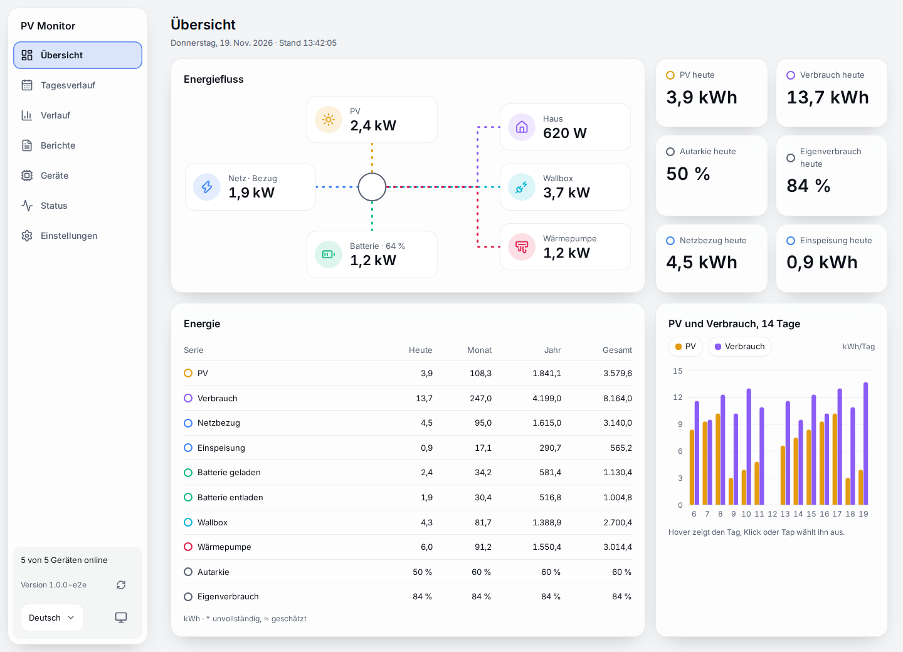

# pvmon

pvmon is a self-hosted monitor for photovoltaic (PV) systems. It reads inverters, batteries,
meters and wallboxes from different vendors. It shows where the electricity of a household
comes from and where it goes. It also shows how self-sufficient the household is and if a
device has a fault.

pvmon only monitors. It does not control devices, it does not calculate costs and it does
not send data to the internet.



## Contents

- [Features](#features)
- [Supported devices](#supported-devices)
- [Installation](#installation)
- [First start](#first-start)
- [Configuration](#configuration)
- [Security](#security)
- [Command line](#command-line)
- [Import from solis](#import-from-solis)
- [Device profiles](#device-profiles)
- [Development](#development)
- [License](#license)

## Features

- Reads devices over Modbus TCP, Modbus RTU (RS485) and HTTP/JSON.
- Describes each device model in a YAML profile. A new model needs no Go code.
- Keeps one energy balance for the site: PV, battery, grid, backup and consumers.
- Stores energy in 15-minute buckets in SQLite. It calculates days, months, years and
  lifetime values from these buckets.
- Shows live values, a day view, history, reports (PDF and CSV) and device status.
- Shows only what your site has. A site without a battery shows no battery.
- Has an English and a German user interface. You can install it as a PWA.
- Has admin accounts, API tokens and an audit log. Read access needs no login (you can
  change this).
- Imports the history of an existing solis database.
- Ships as one binary. The binary contains the user interface, the profiles and the
  database migrations.

## Supported devices

| Profile | Device | Transport | Verified |
| --- | --- | --- | --- |
| `solis/s6-hybrid` | Solis S6 hybrid inverter (and RHI) | Modbus TCP/RTU | yes |
| `shelly/pro-3em` | Shelly Pro 3EM energy meter | HTTP (Gen2) | yes |
| `shelly/3em` | Shelly 3EM energy meter | HTTP (Gen1) | no |
| `eastron/sdm630` | Eastron SDM630 energy meter | Modbus TCP/RTU | no |
| `goe/charger-v2` | go-eCharger (API v2) | HTTP | no |
| `tinkerforge/warp3` | Tinkerforge WARP3 Charger Pro | HTTP | no |
| `opendtu/total` | OpenDTU (Hoymiles micro inverters) | HTTP | no |

"Verified: no" means that the profile comes from the vendor documentation only. It can
contain errors. If you have one of these devices, send a dump (see
[Device profiles](#device-profiles)).

If your device is not in the list, you can write your own profile.

## Installation

pvmon runs on Linux and macOS. Windows is not supported. A Raspberry Pi 3B+ or 4 is
sufficient.

### Docker Compose (recommended)

1. Copy the [example/](example/) directory to your host.
2. Edit `example/config.yaml`. Set the addresses of your devices.
3. Set your time zone in `TZ` in `compose.yaml`.
4. Start pvmon:

   ```bash
   docker compose up -d
   ```

5. Open `http://<host>:8080`.

The image is `ghcr.io/dombyte/pvmon`. It is available for amd64, arm64 and armv7. The
database, the backups and the encryption key are in the volume `/app/data`.

For an RS485 adapter on the host, add the device to `compose.yaml` (see the comments in
the file).

### Binary

1. Download the archive for your platform from the GitHub releases.
2. Extract the archive.
3. Write a `config.yaml` (see [Configuration](#configuration)).
4. Start pvmon:

   ```bash
   TZ=Europe/Berlin ./pvmon -config config.yaml
   ```

pvmon does not restart itself after a fatal error. It stops with exit code 1. Use a
supervisor (systemd, Docker `restart: unless-stopped`) to restart it.

## First start

1. Start pvmon.
2. Find the setup code in the log. The code has 8 characters.
3. Open the user interface. Enter the setup code.
4. Create the first admin account.
5. If your `config.yaml` has no meters, the setup wizard starts. Add your devices, examine
   the live values and save.

You can also create an admin account on the command line (stop the server first):

```bash
printf '%s\n' "$PASSWORD" | pvmon user add admin
```

## Configuration

You can configure pvmon in two ways:

- In the user interface (settings and setup wizard). pvmon applies the changes without a
  restart.
- In `config.yaml` and in environment variables.

You can use both at the same time. The file has priority. An object that is in the file
is locked in the user interface.

A minimal `config.yaml`:

```yaml
site:
  name: Home
  interval: 5s                 # poll interval of all devices

connections:
  lan-solis: { address: "tcp://10.0.0.20:502", timeout: 2s }

devices:
  wr1:   { connection: lan-solis, unit: 1, profile: solis/s6-hybrid }
  meter: { address: "http://10.0.0.31", profile: shelly/pro-3em, interval: 2s }

meters:
  pv:      { device: wr1, source: pv, kwp: 10, label: Roof }
  battery: { device: wr1, source: battery, capacity: 10kWh }
  grid:    { device: meter, source: total }
```

[example/config.yaml](example/config.yaml) shows a full site with two wallboxes.

Rules:

- A site needs exactly one meter with the role `grid`.
- Each duration needs a unit, for example `5s`, `30d` or `10y`.
- The time zone comes only from the environment variable `TZ`.
- Do not write passwords into the file. Use a reference: `${env:NAME}` or
  `${file:/run/secrets/name}`.
- An environment variable overrides a key. Use the prefix `PVMON_` and two underscores
  for each level. Example: `PVMON_APP__LOG_LEVEL=debug` sets `app.log_level`.

Frequently used settings:

| Key | Default | Meaning |
| --- | --- | --- |
| `app.port` | `8080` | HTTP port |
| `app.log_level` | `info` | `debug`, `info`, `warn` or `error` |
| `auth.public_read` | `true` | Read access without login |
| `storage.path` | `./data/pvmon.db` | Database file |
| `storage.retention` | `10y` | How long pvmon keeps data |
| `storage.backup_interval` | `24h` | Interval of the online backups |
| `storage.max_backups` | `3` | Number of backups that pvmon keeps |
| `status.offline_after` | `15m` | Offline time during the day that counts as a fault |
| `log.file` | empty | Log file in addition to stdout |

[SPEC.md](SPEC.md) section 3 gives all keys and rules.

To examine your configuration, use:

```bash
pvmon config validate
pvmon config export      # shows the full configuration as YAML, without secrets
```

## Security

- pvmon serves HTTP only. For access from the internet, put pvmon behind a reverse proxy
  with TLS and authentication.
- With `auth.public_read: true`, all persons in your LAN can read your energy data. Set
  `auth.public_read: false` to prevent this.
- Keep `data/secret.key`. pvmon uses this key to encrypt the device passwords that you
  enter in the user interface. Without the key, you must enter these passwords again.
- pvmon makes no outgoing connections, except to your devices.

## Command line

| Command | Purpose |
| --- | --- |
| `pvmon` or `pvmon serve [-config path]` | Start the server |
| `pvmon version` | Show the build information |
| `pvmon config validate` / `config export` | Examine the configuration |
| `pvmon user add` / `reset-password` / `list` | Manage admin accounts |
| `pvmon token create` / `list` / `revoke` | Manage API tokens |
| `pvmon profile validate <file>` | Examine a profile file |
| `pvmon dump --device <id>` | Record the raw values of a device |
| `pvmon simulate --setup R1..R7` | Run with simulated devices |
| `pvmon import-solis --db <file> --map <file>` | Import a solis database |

Stop the server before you use `user`, `token`, `dump` or `import-solis`. These commands
make and verify a backup before they write. Exit codes: 0 = success, 1 = failure,
2 = usage error.

The REST API is at `/api/v1`. Live values are available over the WebSocket `/ws`. To use
the API from a script, create a token and send it as `Authorization: Bearer <token>`.

## Import from solis

pvmon can import the history of solis, an earlier monitoring application for Solis
inverters.

1. Stop pvmon.
2. Copy [example/import-solis.map.yaml](example/import-solis.map.yaml) and adapt it to
   your meters.
3. Run the import:

   ```bash
   pvmon import-solis --db solis.db --map import-solis.map.yaml
   ```

4. Read the summary. It shows each series, the skipped days and all differences.

pvmon opens the solis database read-only. It imports only the days before its own data.

## Device profiles

A profile describes one device model: registers or JSON paths, scales, signs, counters
and status values. pvmon contains the profiles in [profiles/](profiles/). To use your own
profile, set its path as `profile` of the device:

```yaml
devices:
  meter: { address: "tcp://10.0.0.50:502", unit: 2, profile: ./profiles/my-meter.yaml }
```

To write or examine a profile:

1. Record the raw values of the device. Stop the server first.

   ```bash
   pvmon dump --device meter --count 10 -o meter.fixture.json
   ```

2. Write the profile. [SPEC.md](SPEC.md) section 4 gives the schema.
3. Examine the profile:

   ```bash
   pvmon profile validate ./profiles/my-meter.yaml
   ```

A dump contains only the values that the profile reads. Profiles do not read serial
numbers.

## Development

- [SPEC.md](SPEC.md) is the specification of the application: behaviour, configuration,
  profiles, storage, API, user interface and acceptance gates.
- [AGENTS.md](AGENTS.md) gives the rules for the codebase: structure, architecture, code
  rules, tests, dependencies and the Git workflow. It applies to persons and to coding
  agents.

```bash
make build                       # build ./pvmon with the version from git
go run ./cmd simulate --setup R3 # run with simulated devices
make check                       # all checks of the CI
```

To build, you need Go 1.27.4 and Node.js for the frontend. Read AGENTS.md before you
send a pull request.

## License

MIT, see [LICENSE](LICENSE).
